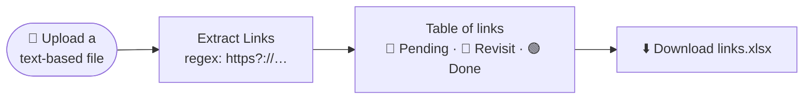

<div align="center">

# 📄 DocXtract

**Pull every link out of a document in one click, track which ones you've completed, and export the list as an Excel tracker.**

[](https://doc-xtract.vercel.app)


-217346?style=flat-square&logo=microsoftexcel&logoColor=white)


[Why](#-why) · [How it works](#-how-it-works) · [Features](#-features) · [Getting Started](#-getting-started)

</div>

---

## 🤔 Why?

Course notes, reading lists and study sheets are full of links. DocXtract turns them into a **checklist you can actually work through** — mark each link as *Pending*, *Revisit* or *Done*, then download it as a spreadsheet.

## 🔄 How it works



Everything runs **in your browser** — the file is never uploaded to a server.

## ✨ Features

| | Feature |
|---|---|
| 🔗 | Finds every `http://` and `https://` URL in the file, even across line breaks |
| 🗂️ | Shows links in a clean Material UI table |
| 🎨 | Colour-coded status dropdown per link — **Pending**, **Revisit**, **Done** |
| 📊 | Exports a `links.xlsx` with `Link` and `Completion State` columns |
| 🌑 | Dark theme out of the box |

**Works with:** text-based files such as `.txt`, `.md`, `.html`, `.csv` and `.json`.

## 🚀 Getting Started

```bash
git clone https://github.com/Shariq2003/DocXtract.git
cd DocXtract
npm install
npm start            # http://localhost:3000
```

<details>
<summary><b>📜 Available scripts</b></summary>

| Command | What it does |
|---|---|
| `npm start` | Run the dev server |
| `npm run build` | Production build into `build/` |
| `npm test` | Run tests |

</details>

<details>
<summary><b>📁 Project structure</b></summary>

```text
src/
├── components/Form.js   # upload, extraction, status table, Excel export
├── App.js
└── index.js
```

</details>

---

<div align="center">

Built by **[Shariq](https://github.com/Shariq2003)** · [LinkedIn](https://www.linkedin.com/in/shariq-sd)

⭐ If you like this project, consider giving it a star!

</div>
